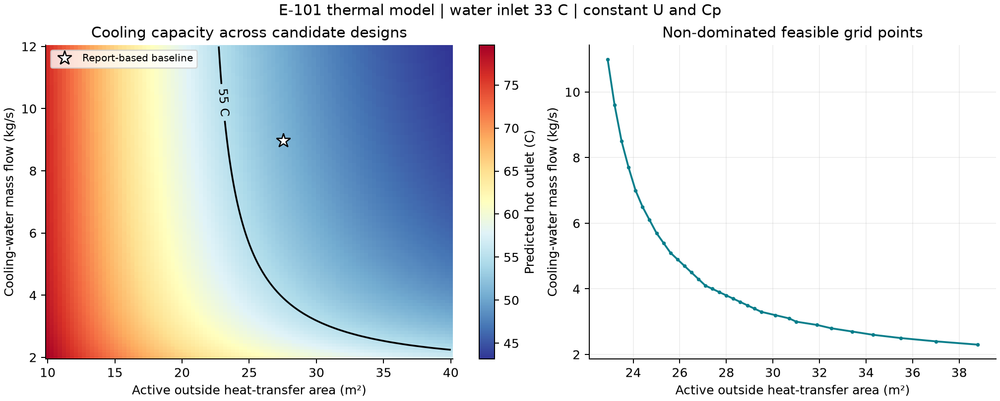
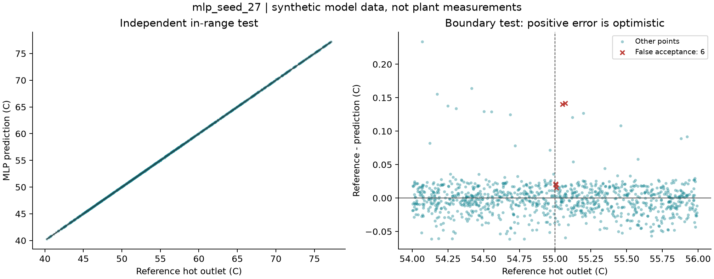
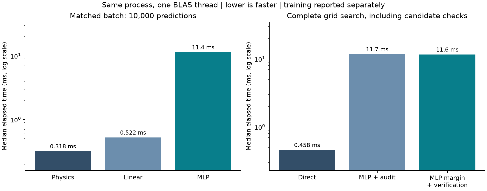

# Crude-glycerol cooling: physical model and surrogate design study

A runnable chemical-engineering / machine-learning starter project based on the
E-101 design case in a CHEE2050 group course report. It predicts exchanger outlet
temperatures, searches area/water-flow trade-offs, and checks whether a learned
surrogate makes reliable design decisions near a 55°C cooling requirement.

**Main result:** a small MLP approximated the reference model with **0.0149°C test
MAE**, yet **2 of its 6 raw design recommendations** violated the reference-model
temperature constraint. Validation-calibrated margin plus physical verification
produced feasible choices in **6/6 tested cases**. The direct algebraic physical
model was faster than the MLP. These are synthetic-model results, not plant validation.

## Run it

Python 3.11-3.13 is supported; the recorded run used Python 3.12.14 on Windows.
Run commands from the repository root. With [uv](https://docs.astral.sh/uv/):

```powershell
uv sync --locked --extra dev
uv run --locked --extra dev python -m pytest -q
uv run --locked --extra dev python -m cooling_project report
uv run --locked --extra dev python -m cooling_project predict
uv run --locked --extra dev python -m cooling_project experiment --output runs/my-first-run
```

Use a new output directory for each run; existing results are never overwritten.
To run only the physical design search:

```powershell
uv run --locked --extra dev python -m cooling_project search --output runs/my-search
uv run --locked --extra dev python -m cooling_project predict --area 20 --water-flow 8.971 --water-inlet 33
```

Without uv, create a virtual environment and `python -m pip install -e ".[dev]"`.
The committed `uv.lock` pins the dependencies used for the recorded experiment;
an unconstrained pip install may resolve different versions.

## Engineering question

The nominal hot stream is 6000 kg/h of crude glycerol entering at 110°C. Within
the declared model, find equivalent active outside areas A and cooling-water
mass flows m that achieve hot outlet <=55°C. Compare their dimensionless trade-off:

```
J = w * A / A_reference + (1 - w) * m / m_reference
```

This score is not monetary cost. Water inlet temperature is an external scenario,
not a design variable the optimizer is allowed to improve for itself.

The reference is an idealized **one-shell / even-tube-pass ε-NTU model**, matching
the report's one-shell/four-pass arrangement, with constant Cp and effective U.
Its inputs and source pages are in [the model specification](docs/model_spec.md)
and [parameter provenance](docs/sources.csv).
The original [104-page group course report](docs/references/PDC_Final_report.pdf)
is included unchanged at the user's request, with a [source and integrity note](docs/references/README.md).

The report-reproduction configuration preserves the report's rounded 1.667 kg/s
flow and distinguishes gross from effective area. The project configuration uses
exactly 6000/3600 kg/s and an effective-area baseline of 27.5470 m². At the default
water conditions, the forward model predicts **51.1623°C hot outlet**, **40.4868°C
water outlet** and **280.7442 kW** exchanged heat. The report's 315.112 kW capacity
check at prescribed design endpoints is a different quantity.



## Experiment and observed results

The [protocol](docs/experiment_protocol.md) was saved before fitting: 4000 training,
1000 validation and 1000 independent in-range test samples; another 1000 points near
55°C and 1000 at higher water inlet temperatures. Features are A, water flow and
water inlet temperature. All labels come from the reference calculation.

One linear baseline and one MLP configuration with three initialization seeds were
fitted. Input/target standardizers use training data only. Seed 27 was selected by
validation MAE before the final tests; all seeds' metrics remain in the results.

| Evaluation | Linear baseline | Selected MLP |
|---|---:|---:|
| In-range test MAE, °C | 1.9097 | 0.0149 |
| In-range absolute-error 95th percentile, °C | 4.2607 | 0.0380 |
| In-range false acceptances / predicted feasible | 15/438 | 1/496 |
| Final raw design choices feasible under reference | 0/6 | 4/6 |

The selected MLP's boundary test had **6/500 false acceptances (1.20%)**. Adding
the validation-selected 0.0562°C margin reduced this to **2/474 (0.42%)**, so margin
alone is not a guarantee. Every final proposed design is checked with the reference.
The guarded/verified MLP route returned 6/6 feasible designs; their mean score gap
was **0.160%**, relative to the best feasible points on the same 101×101 grid.
Six scenario/weight combinations are a small decision test, not a reliability guarantee.

The two rejected raw MLP choices exceeded 55°C by about **0.0141°C and 0.0030°C**.
They illustrate a strict model-level decision boundary, not demonstrated industrial
hazards. Engineering model uncertainty is separate from this surrogate error.



| Measured median time on the recorded machine | Direct physics | MLP |
|---|---:|---:|
| 10,000-point batch | 0.318 ms | 11.406 ms |
| Complete grid search | 0.458 ms | 11.724 ms, including raw-choice audit |

Guarded MLP search plus verification took 11.619 ms. All four model fits together
took 7.33 s; dataset generation and margin calibration took about 0.0066 s and
0.0428 s respectively. The complete run, including files and plots, took 9.93 s
after dependencies were installed. Timings use one BLAS thread, warmups and eleven
repeats; they are machine/load dependent. There is **no measured speed advantage
for replacing this simple physical model with the MLP**.



## Evidence and reproducibility

- [Result summary](results/baseline/summary.json), [training records](results/baseline/training.json)
  and [raw timing repetitions](results/baseline/timings.json).
- [Dataset](results/baseline/dataset.csv), [predictions](results/baseline/predictions.csv),
  [designs](results/baseline/designs.csv), and [all attempted candidate checks](results/baseline/candidate_audits.csv).
- [Frozen configuration](results/baseline/frozen_config.json),
  [selection and margins](results/baseline/frozen_selection.json),
  and [source/config/output hashes and environment](results/baseline/manifest.json).
- **40 tests passed** in both the primary and a newly created second virtual
  environment. Tests include independent `ht` comparisons, an F-LMTD root check,
  conservation, limiting cases, data separation and rejected-candidate retention.
- A full rerun in the second environment matched the data, predictions, selected
  model, numerical metrics and design summaries exactly. Timings naturally differ.
  See [verification record](results/verification.json).
- GitHub Actions runs the numerical tests, saved-result audit and source-PDF hash
  check on pushes and pull requests. Workflow status is available in the repository's Actions tab.

```powershell
uv run --locked --extra dev python scripts/verify_results.py results/baseline
# After making another complete run:
uv run --locked --extra dev python scripts/verify_results.py results/baseline runs/my-first-run
```

Git attributes preserve source line endings and the exact bytes of saved evidence
across checkouts. The verifier requires unchanged executable-source hashes for these archived
results. After changing code, create a new experiment snapshot rather than
claiming the old snapshot was produced by the new code.

## Structure and boundaries

```
configs/                    Report basis and frozen experiment settings
src/cooling_project/
  report_case.py            Appendix B arithmetic reproduction
  physics.py               Vectorized reference thermal model
  design.py                Grid search, Pareto points and candidate verification
  data.py / surrogate.py   Independent samples and fitted proxies
  evaluate.py / plots.py   Metrics, fair timing and figures
  experiment.py / cli.py   Reproducible workflow and command line
tests/                      Numerical and experiment-contract checks
results/baseline/            Inspectable completed run
docs/                       Sources, decisions, explanation and contributions
```

This version does not validate physical equipment, pressure drop, flow-dependent U,
temperature-dependent mixture properties, real operating cost or dynamic control.
The report's unresolved fouling-area convention and hydraulic formula discrepancy
are documented rather than hidden. The included PDF retains the original group's attribution;
it is supporting source material, not evidence of real-plant validation.

The user defined the goal, provided sources, selected the simulated-data/design
route and authorized execution. AI assisted with implementation, experiments and
documentation. See the [actual contribution record](docs/contribution_log.md).

中文：[方法与学习入口](docs/methods_zh.md) · [结果解读](docs/results_zh.md) ·
[当前进度](PROJECT_STATE.md)
